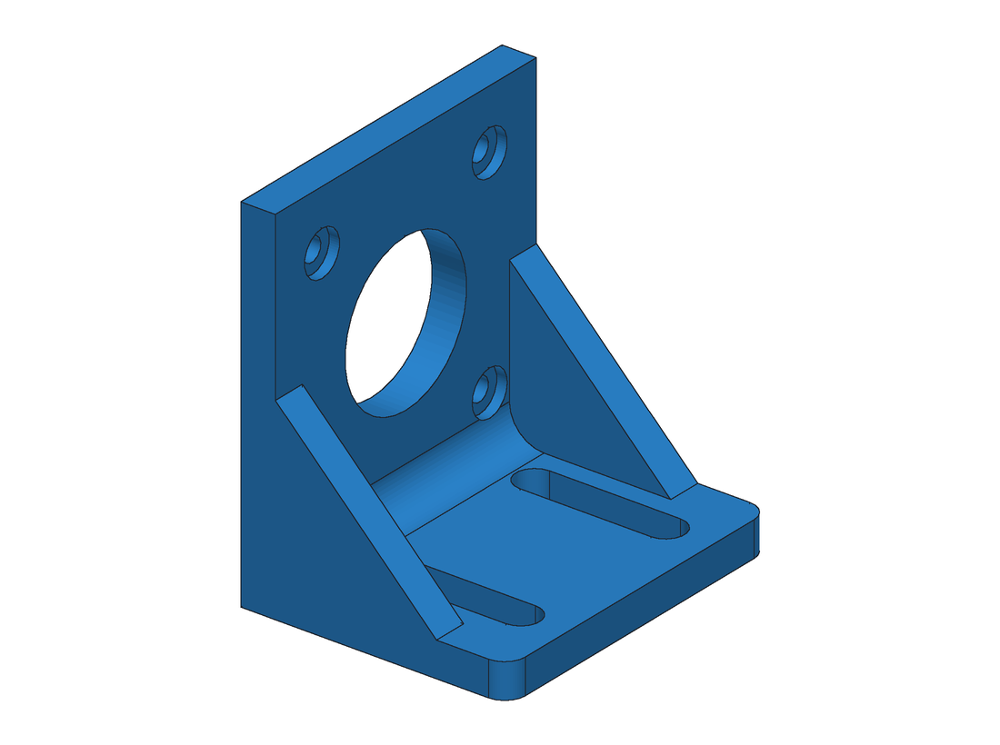
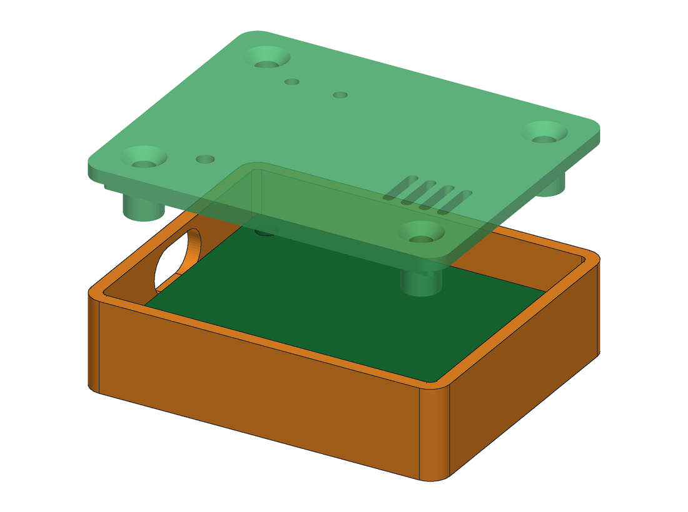
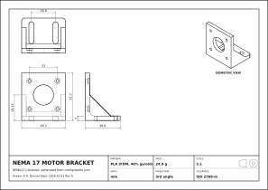

# FreeCAD parametric parts: generation and validation pipeline

Code-CAD mechanical parts built with FreeCAD's Python API (the OpenCascade B-rep kernel). The repo
contains a family of **NEMA stepper-motor brackets** and a **two-part 3D-printable enclosure** that is
generated from the interface description of a PCB. Every part is checked automatically before it is
exported: topology, dimensions, presence of features, interference with mating parts, fasteners
and manufacturability. The run is fully headless (`FreeCADCmd`), so it can gate a CI pipeline.

| NEMA 17 bracket | Enclosure (exploded, with PCB) |
|---|---|
|  |  |

**127 / 127 automated checks pass** on the 4 generated parts. See [output/VALIDATION.md](output/VALIDATION.md).

## What gets generated

For every entry in [`configs/parts.json`](configs/parts.json), `generate.py` writes to `output/<id>/`:

| File | Content |
|---|---|
| `*.FCStd` | Native FreeCAD document: the solids plus a `Parameters` spreadsheet with the inputs |
| `*.step` | STEP AP214 for any CAD/CAM tool (the enclosure is exported as an assembly) |
| `*.stl` | Print-ready mesh (the lid is flipped into print orientation). GitHub shows these in a 3D viewer |
| `drawing*.svg` | A4 technical drawing: third-angle front/top/right views with hidden lines, an isometric view, dimensions and a title block (material, mass, scale, tolerance class) |
| `preview.png`, `assembly.png`, `exploded.png` | Shaded renders with CAD edges |
| `report.json` | Every check with its measured value |



## The parts

### NEMA 14 / 17 / 23 motor bracket ([`cadlib/bracket.py`](cadlib/bracket.py))
An L-bracket with a pilot bore, a counterbored NEMA hole pattern, two adjustment slots in the base,
triangular gussets and a filleted inner bend. All dimensions come from a small table of NEMA ICS 16
frame data and ISO 4762 screw data, so a new motor size is just one config entry. Fillet edges are
picked by geometric predicates instead of edge indices, which keeps them stable when parameters
change (FreeCAD's topological naming problem).

| Variant | Envelope (mm) | Material | Mass |
|---|---|---|---|
| NEMA 14 | 41.2 × 32.2 × 44.2 | PLA | 13.6 g |
| NEMA 17 | 48.3 × 38.8 × 52.3 | PLA | 24.9 g |
| NEMA 23 | 69.4 × 51.1 × 70.9 | Al 6061-T6 | 118.8 g |

### Sensor-node enclosure ([`cadlib/enclosure.py`](cadlib/enclosure.py))
This is the case for the board in [esp32c3-sensor-node-pcb](https://github.com/Alexden28/esp32c3-sensor-node-pcb).
The geometry is derived from the board's interface data (outline, mounting holes, USB-C position,
LED, buttons, sensor location, component height):
- the PCB is clamped between bosses in the base and standoffs hanging from the lid;
- four M3 countersunk screws go through lid, standoff and PCB into the bosses (the pipeline picks
  the screw length, **M3×14 ISO 10642**, and checks thread engagement);
- a stadium-shaped USB-C cutout, a locating lip on the lid, vents above the humidity sensor, an LED
  light hole and pinholes for RESET/BOOT.

## Validation

[`cadlib/validate.py`](cadlib/validate.py) runs these checks on the generated B-rep:

| Category | Checks |
|---|---|
| Topology | BRepCheck validity, exactly one solid, watertight shells, positive volume |
| Dimensions | Bounding box against the spec envelope |
| Features | Every hole exists as a cylindrical face with the right diameter, on the right axis |
| Interference | Zero-volume intersection with the mating parts: motor body, pilot, shaft, GT2 pulley, screw heads, hex-key access paths, PCB, top-side components, USB-C plug, lid vs base |
| Fasteners | A standard screw length exists for the clamp stack; thread engagement ≥ 1.3·d |
| Manufacturability | Minimum webs (counterbore to bore, under counterbores, bridges over cutouts, boss walls), FDM wall ≥ 4 perimeters |

During development the checks caught real design errors:
1. **NEMA 23: the gussets blocked the lower screw heads and the hex-key access**
   (165 mm³ overlap) at a 4 mm side margin. Fixed by widening the bracket (`margin` 6.5).
2. **NEMA 23: the inner bend fillet touched the M5 heads** (0.05 mm³). The heads stand 2.5 mm
   proud of the plate and the 6 mm fillet climbs up to them. Fixed with a 4 mm bend radius.
3. **Enclosure: the USB-C plug did not fit through the cutout**, and the bridge above the cutout
   was only 0.47 mm. Fixed by raising the walls and modelling the plug overmold with its real
   rounded shape.

## Running

Requires [FreeCAD 1.x](https://www.freecad.org/) (it ships with Python, numpy and Pillow). No GUI is needed:

```bash
# Windows
"C:\Program Files\FreeCAD 1.1\bin\FreeCADCmd.exe" generate.py
# Linux / macOS
freecadcmd generate.py
```

The exit status is non-zero if any check fails. A full run of all four parts takes about 20 s.

## Layout

```
generate.py            pipeline: build, validate, export, draw, render, report
configs/parts.json     part definitions (motor sizes, materials, enclosure + PCB interface)
cadlib/
  geom.py              geometry helpers, rounded boxes, slots, view matrices
  bracket.py           NEMA bracket generator, mating envelopes, analytic webs
  enclosure.py         enclosure generator, screw stack, mating envelopes
  validate.py          automated checks and report
  drawing.py           TechDraw HLR projections into a dimensioned A4 SVG
  render.py            z-buffer rasterizer in numpy for the preview images
  export.py            FCStd (with parameter spreadsheet), STEP, STL
output/                generated files (committed so they can be browsed on GitHub)
```

## Tools

FreeCAD 1.1 (Part / OpenCascade, TechDraw hidden-line removal, MeshPart, Spreadsheet), Python 3.11,
numpy, Pillow and headless Microsoft Edge (to preview the SVG drawings). Developed with AI-assisted
pair programming (Claude Code).

## License

MIT
